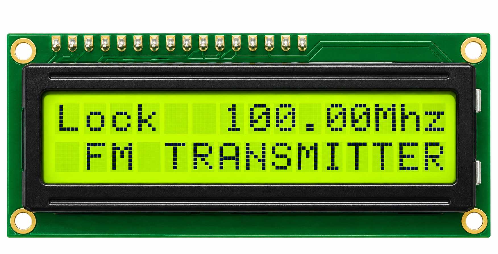
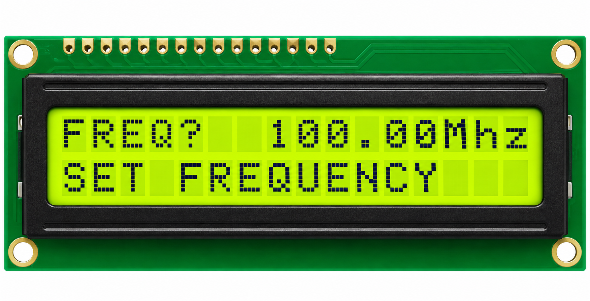
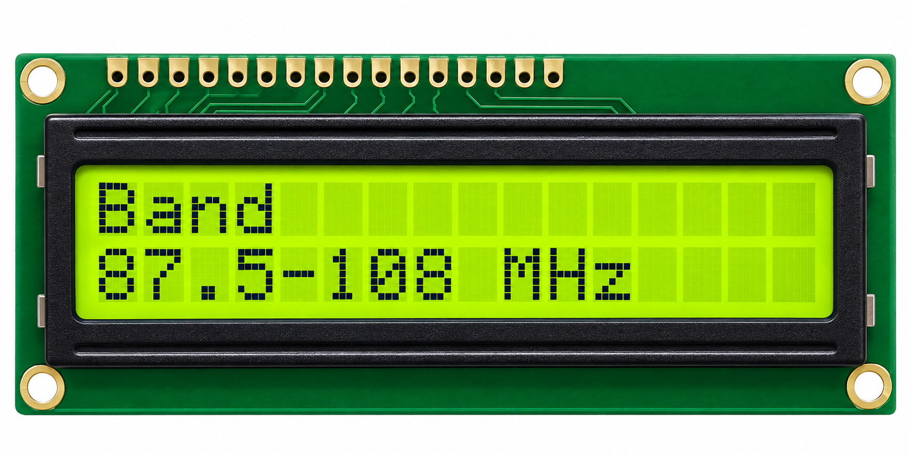
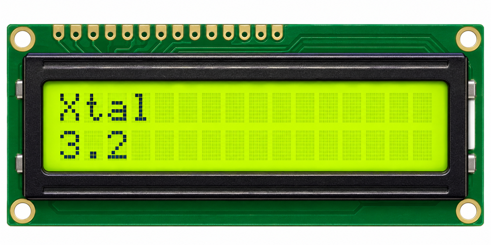
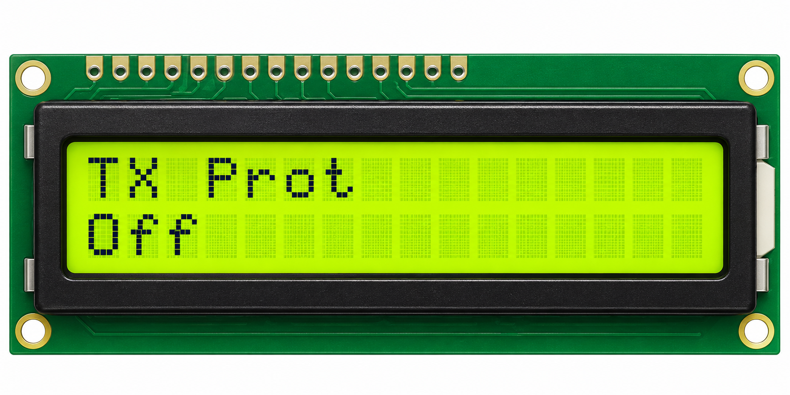

# TSA5511 PLL Controller

A **Yps Broadcast** project · Firmware 2.4

[English](#english) | [Português](#portugues)

<a id="english"></a>

## English

Firmware written in Proton BASIC to control a TSA5511 PLL synthesizer, developed for PIC16F627, PIC16F627A, PIC16F628 and PIC16F628A. It provides frequency adjustment on a 16 × 2 character LCD, configuration through three buttons, and RF power amplifier control through the TSA5511 P2 output.

**Version 2.4 · HEX firmware distribution · A Yps Broadcast project**

### Features

- Frequency adjustment using UP and DOWN, with automatic repeat while a button is held.
- Selectable frequency ranges of 76.00–108.00 MHz and 87.50–108.00 MHz.
- TSA5511 reference crystal selection, with 50 kHz steps for 3.2 MHz and 100 kHz steps for 6.4 MHz.
- Configuration menu accessed by holding SET.
- Frequency and menu settings stored in EEPROM.
- Automatic restoration of saved settings at power-up.
- RF power amplifier control through P2, used with a 2SC1971 in the author's setup.
- Choice of periodic PLL monitoring or initial lock confirmation only.
- Loss-of-lock confirmation using consecutive readings to tolerate brief disturbances.
- Lock indication on the LCD and a dedicated LED.
- Frequency displayed in a fixed column during lock acquisition, locked operation and adjustment.

### LCD1602 screen previews

Illustrative renderings of a 1602 LCD, based on the firmware screens.

| Screen | Preview |
|---|---|
| Locked operation |  |
| Frequency adjustment |  |
| Band selection |  |
| Crystal selection |  |
| TX Prot selection |  |

### Available firmware

Choose the HEX file matching the exact PIC model installed.

| Microcontroller | Firmware |
|---|---|
| PIC16F627 | [PIC16F627_Menu.hex](Versoes_Menu/PIC16F627_Menu.hex) |
| PIC16F627A | [PIC16F627A_Menu.hex](Versoes_Menu/PIC16F627A_Menu.hex) |
| PIC16F628 | [PIC16F628_Menu.hex](Versoes_Menu/PIC16F628_Menu.hex) |
| PIC16F628A | [PIC16F628A_Menu.hex](Versoes_Menu/PIC16F628A_Menu.hex) |

All four variants have been compiled for their respective devices, and the HEX files have been checked. Each variant uses 1,020 program memory words. Operation should be verified on the hardware being used.

### Programming and first power-up

1. Select the exact PIC model in your programmer software.
2. Open the matching HEX file and use the configuration included in the file.
3. Program and verify the device.
4. Power up the equipment and check **Band**, **Xtal** and **TX Prot** in the menu.

The firmware uses the PIC's internal oscillator at 4 MHz. **Xtal** selects the crystal used by the TSA5511.

When EEPROM does not contain valid settings, the supplied HEX files use these defaults.

| Setting | Default |
|---|---|
| Band | 87.50–108.00 MHz |
| Xtal | 3.2 MHz |
| TX Prot | Off |

**Settings already stored in EEPROM take priority over the firmware defaults.** Whether EEPROM is preserved or erased when reprogramming depends on the programmer settings.

If the restored frequency is invalid or outside the selected band, the controller uses 108.00 MHz.

### Adjusting the frequency

1. Briefly press and release **SET**.
2. Use **UP** to increase or **DOWN** to decrease the frequency.
3. Hold UP or DOWN to move through multiple steps.
4. Press **SET** again to save the frequency and leave adjustment mode.

Going above the upper limit returns to the lower limit. Going below the lower limit returns to 108.00 MHz.

During adjustment, the firmware sends the command to disable P2. On exit, it programs the selected frequency and waits for lock before enabling the RF power amplifier again.

### Configuration menu

Hold **SET** for approximately **2 seconds** to enter the menu. Use **UP** or **DOWN** to toggle between the two choices for each setting, and **SET** to advance.

| Order | LCD setting | Choices | Function |
|---|---|---|---|
| 1 | Band | 76.0–108 MHz / 87.5–108 MHz | Sets the frequency adjustment limits. |
| 2 | Xtal | 3.2 / 6.4 | Selects the reference crystal installed on the TSA5511. |
| 3 | TX Prot | On / Off | Selects PLL monitoring after initial lock. |

Pressing SET on **TX Prot** saves all three settings in EEPROM and applies them. The controller then waits for lock again.

The RF power amplifier is disabled when entering the menu. **Xtal** must match the crystal physically installed on the TSA5511.

#### Crystal and frequency step

| TSA5511 crystal | Adjustment step | Example |
|---|---|---|
| 3.2 MHz | 50 kHz | 100.00 → 100.05 → 100.10 MHz |
| 6.4 MHz | 100 kHz | 100.00 → 100.10 → 100.20 MHz |

Frequency is saved separately for each crystal selection. When changing the crystal setting, the firmware restores the frequency previously saved for that selection and checks it against the selected band.

### TX Prot operation

#### On — periodic monitoring

The PIC reads the PLL status approximately **once per second**. After obtaining lock, it enables P2 and continues monitoring the synthesizer.

The firmware requires **4 consecutive readings without lock** before sending the command to disable the RF power amplifier. Approximately 3 seconds separate the first and fourth readings, corresponding to roughly **3–4 seconds from the actual loss of lock**. A reading with lock resets the counter.

A reset reported by the TSA5511 or an invalid I²C read returns the firmware to lock acquisition and causes it to send the command to disable P2 as soon as the condition is detected during a status read.

#### Off — initial lock only

The PIC reads the TSA5511 until lock is confirmed and P2 is enabled. It then stops reading the PLL status until a new adjustment is started.

**P2 remains enabled even if the PLL subsequently loses lock.** The LCD and LED retain the indication of the initial confirmed lock. SET still allows access to frequency adjustment or the menu.

#### Monitoring timing and limitations

In the supplied HEX files, the **first valid reading with lock** is sufficient to enable P2. The PIC observes the status reported by the TSA5511, so periodic polling can miss disturbances that begin and end between readings.

P2 remains enabled while loss of lock is being confirmed. Disabling it depends on the I²C command reaching the TSA5511. A physical bus fault can prevent that write.

### LCD and indicators

The frequency always starts in **column 8** of the first line.

```text
UnLock 100.00Mhz
Lock   100.00Mhz
FREQ?  100.00Mhz
```

| Display | Meaning |
|---|---|
| UnLock / Waiting lock | The firmware is waiting for lock confirmation. |
| Lock / FM TRANSMITTER | P2 has been enabled after lock confirmation. |
| FREQ? / SET FREQUENCY | Frequency adjustment is active. |
| Saved | The frequency has been stored in EEPROM. |

The LED on **RA4** is active low and follows the state indicated by the firmware. The auxiliary LED on **RA2** turns on at power-up and can be turned off using DOWN while waiting for or monitoring the PLL.

### Firmware pin assignments

| Function | PIC connection |
|---|---|
| I²C SDA | RA1 |
| I²C SCL | RA0 |
| LCD D4 | RB0 |
| LCD D5 | RB1 |
| LCD D6 | RB2 |
| LCD D7 | RB3 |
| LCD RS | RB4 |
| LCD EN | RA3 |
| UP button | RB5 |
| SET button | RB6 |
| DOWN button | RB7 |
| Auxiliary LED | RA2 |
| Lock LED | RA4 |

The buttons are active high and require a defined low level when released. SDA and SCL require pull-up resistors. RA4 is an open-drain output, so the LED must be wired for active-low operation. [PIC16F627/628 datasheet](https://ww1.microchip.com/downloads/en/DeviceDoc/40300c.pdf)

The **TSA5511 P2 output** controls the RF power amplifier enable circuit. The firmware uses P2 for this function and keeps P4 and P5 disabled.

### Supplied firmware profile

| Parameter | Value |
|---|---|
| Version displayed on the LCD | 2.4 |
| LCD | 16 × 2 characters, 4-bit interface |
| PIC oscillator | Internal, 4 MHz |
| PLL polling | Approximately once per second |
| Initial lock confirmation | 1 valid reading with lock |
| Loss-of-lock confirmation | 4 consecutive readings without lock |
| UP/DOWN button confirmation | 20 ms |
| UP/DOWN repeat pause | 150 ms |
| Menu access | Hold SET for approximately 2 s |
| TSA5511 I²C address | 0x61 in 7-bit format, equivalent to 0xC2 for writing and 0xC3 for reading |
| TSA5511 control byte | 0x8E, 50 µA charge pump |
| EEPROM, 3.2 MHz crystal | Frequency at addresses 2 and 3 |
| EEPROM, 6.4 MHz crystal | Frequency at addresses 4 and 5 |
| EEPROM, menu settings | Address 6 |

Lock status comes from the TSA5511 FL bit. Firmware timing controls the PIC's response and P2 activation. Oscillator settling time also depends on the VCO and loop filter. [TSA5511 datasheet](https://dtsheet.com/doc/203359/philips-tsa5511)

### License

The published firmware and documentation are distributed under the **MIT License**. Personal and commercial use, modification and redistribution are permitted, provided that the copyright and license notice are preserved. The MIT License does not require publication of the source code. [Read the license](LICENSE)

### Author

A **Yps Broadcast** project, compatible with several RDVV versions.

[GitHub profile ypselon](https://github.com/ypselon)

---

<a id="portugues"></a>

## Português

Firmware em Proton BASIC para controlo de um sintetizador PLL TSA5511, desenvolvido para PIC16F627, PIC16F627A, PIC16F628 e PIC16F628A. Permite ajustar a frequência num LCD de 16 × 2 caracteres, configurar o equipamento através de três botões e comandar o andar final de RF pela saída P2 do TSA5511.

**Versão 2.4 · Distribuição em HEX · Projeto Yps Broadcast**

### Funções disponíveis

- Ajuste de frequência com os botões UP e DOWN, incluindo repetição ao manter o botão premido.
- Seleção entre as faixas de 76,00–108,00 MHz e 87,50–108,00 MHz.
- Seleção do cristal de referência do TSA5511, com passos de 50 kHz para 3,2 MHz e 100 kHz para 6,4 MHz.
- Menu acessível por pressão longa no botão SET.
- Gravação da frequência e das opções do menu na EEPROM.
- Recuperação automática das escolhas ao ligar o equipamento.
- Controlo do andar final de RF através de P2, utilizado na montagem com o 2SC1971.
- Escolha entre vigilância periódica do PLL e confirmação apenas do lock inicial.
- Confirmação de perda de lock por leituras consecutivas, para tolerar perturbações breves.
- Indicação de lock no LCD e num LED dedicado.
- Frequência alinhada na mesma coluna nos estados de espera, lock e ajuste.

### Pré-visualização dos ecrãs LCD1602

Representações ilustrativas de um LCD 1602, baseadas nos ecrãs do firmware.

| Ecrã | Pré-visualização |
|---|---|
| Funcionamento com lock |  |
| Ajuste de frequência |  |
| Seleção da faixa |  |
| Seleção do cristal |  |
| Seleção de TX Prot |  |

### Firmware disponível

Escolhe o HEX correspondente à referência exata do PIC instalado.

| Microcontrolador | Firmware |
|---|---|
| PIC16F627 | [PIC16F627_Menu.hex](Versoes_Menu/PIC16F627_Menu.hex) |
| PIC16F627A | [PIC16F627A_Menu.hex](Versoes_Menu/PIC16F627A_Menu.hex) |
| PIC16F628 | [PIC16F628_Menu.hex](Versoes_Menu/PIC16F628_Menu.hex) |
| PIC16F628A | [PIC16F628A_Menu.hex](Versoes_Menu/PIC16F628A_Menu.hex) |

As quatro variantes foram compiladas para os respetivos dispositivos e os ficheiros HEX foram verificados. Cada variante utiliza 1 020 palavras de memória de programa. A validação do funcionamento deve ser feita na montagem utilizada.

### Gravação e primeiro arranque

1. Seleciona o modelo exato do PIC no software do programador.
2. Abre o ficheiro HEX correspondente e utiliza a configuração incluída no ficheiro.
3. Grava e verifica o dispositivo.
4. Liga o equipamento e confirma as opções de **Band**, **Xtal** e **TX Prot** no menu.

O firmware usa o oscilador interno do PIC a 4 MHz. A opção **Xtal** refere-se ao cristal do TSA5511.

Quando a EEPROM ainda não contém uma configuração válida, os HEX fornecidos usam estes valores iniciais.

| Opção | Valor inicial |
|---|---|
| Band | 87,50–108,00 MHz |
| Xtal | 3,2 MHz |
| TX Prot | Off |

**As escolhas já guardadas na EEPROM têm prioridade sobre os valores iniciais do firmware.** A preservação ou limpeza da EEPROM durante uma nova gravação depende das opções do programador.

Se a frequência recuperada estiver fora da faixa selecionada ou for inválida, o equipamento utiliza 108,00 MHz.

### Ajustar a frequência

1. Carrega brevemente em **SET** e larga o botão.
2. Usa **UP** para subir ou **DOWN** para descer a frequência.
3. Mantém UP ou DOWN premido para percorrer vários passos.
4. Carrega novamente em **SET** para gravar a frequência e sair do ajuste.

Ao ultrapassar o limite superior, a seleção regressa ao limite inferior. Ao descer abaixo do limite inferior, regressa a 108,00 MHz.

Durante o ajuste, o firmware envia o comando para desativar P2. Ao sair, programa a frequência escolhida e aguarda pelo lock antes de voltar a habilitar o andar final.

### Menu de configuração

Mantém **SET** premido durante cerca de **2 segundos** para entrar no menu. Usa **UP** ou **DOWN** para alternar entre as duas escolhas de cada opção e **SET** para avançar.

| Ordem | Opção no LCD | Escolhas | Função |
|---|---|---|---|
| 1 | Band | 76.0–108 MHz / 87.5–108 MHz | Define os limites do ajuste de frequência. |
| 2 | Xtal | 3.2 / 6.4 | Seleciona o cristal de referência montado no TSA5511. |
| 3 | TX Prot | On / Off | Define a vigilância do PLL após o lock inicial. |

Ao carregar em SET na opção **TX Prot**, as três escolhas são gravadas na EEPROM e aplicadas. O equipamento volta a aguardar pelo lock.

O andar final é desabilitado à entrada no menu. A escolha em **Xtal** deve corresponder ao cristal fisicamente montado no TSA5511.

#### Cristal e passo de frequência

| Cristal do TSA5511 | Passo de ajuste | Exemplo |
|---|---|---|
| 3,2 MHz | 50 kHz | 100,00 → 100,05 → 100,10 MHz |
| 6,4 MHz | 100 kHz | 100,00 → 100,10 → 100,20 MHz |

A frequência fica guardada separadamente para cada opção de cristal. Ao mudar de cristal, o firmware recupera a frequência anteriormente guardada para essa opção e verifica se está dentro da faixa selecionada.

### Funcionamento de TX Prot

#### On — vigilância periódica

O PIC consulta o estado do PLL aproximadamente **uma vez por segundo**. Depois de obter o lock, ativa P2 e continua a vigiar o sintetizador.

São necessárias **4 leituras consecutivas sem lock** para enviar o comando de corte do andar final. Há cerca de 3 segundos entre a primeira e a quarta leitura, correspondendo aproximadamente a **3–4 segundos desde a perda real de lock**. Uma leitura com lock reinicia a contagem.

Um reset assinalado pelo TSA5511 ou uma leitura I²C inválida fazem o firmware regressar à espera de lock e enviar o comando para desativar P2, assim que a situação é detetada na consulta.

#### Off — apenas lock inicial

O PIC consulta o TSA5511 até confirmar o lock e ativar P2. A partir desse momento, deixa de consultar o estado do PLL até ser iniciado um novo ajuste.

**P2 mantém-se ativo mesmo que o PLL perca lock depois.** O LCD e o LED conservam a indicação do lock confirmado inicialmente. O botão SET continua a permitir entrar no ajuste ou no menu.

#### Tempos e limites da vigilância

Nos HEX fornecidos, basta a **primeira leitura válida com lock** para habilitar P2. O PIC observa o estado comunicado pelo TSA5511, pelo que a consulta periódica pode deixar passar perturbações que comecem e terminem entre leituras.

Durante o tempo de confirmação da perda de lock, P2 permanece ativo. O corte depende de o comando I²C chegar ao TSA5511. Uma falha física do barramento pode impedir essa escrita.

### LCD e indicadores

A frequência começa sempre na **coluna 8** da primeira linha.

```text
UnLock 100.00Mhz
Lock   100.00Mhz
FREQ?  100.00Mhz
```

| Indicação | Significado |
|---|---|
| UnLock / Waiting lock | O firmware aguarda pela confirmação de lock. |
| Lock / FM TRANSMITTER | P2 foi habilitado após a confirmação de lock. |
| FREQ? / SET FREQUENCY | Ajuste de frequência ativo. |
| Saved | A frequência foi gravada na EEPROM. |

O LED ligado a **RA4** é ativo a nível baixo e acompanha o estado indicado pelo firmware. O LED auxiliar em **RA2** acende no arranque e pode ser apagado com DOWN durante a espera ou vigilância do PLL.

### Ligações utilizadas pelo firmware

| Função | Ligação ao PIC |
|---|---|
| I²C SDA | RA1 |
| I²C SCL | RA0 |
| LCD D4 | RB0 |
| LCD D5 | RB1 |
| LCD D6 | RB2 |
| LCD D7 | RB3 |
| LCD RS | RB4 |
| LCD EN | RA3 |
| Botão UP | RB5 |
| Botão SET | RB6 |
| Botão DOWN | RB7 |
| LED auxiliar | RA2 |
| LED de lock | RA4 |

Os botões são lidos como ativos a nível alto e precisam de um nível baixo definido em repouso. SDA e SCL requerem resistências de pull-up. RA4 é uma saída de dreno aberto, pelo que a ligação do LED deve permitir o acionamento a nível baixo. [Datasheet PIC16F627/628](https://ww1.microchip.com/downloads/en/DeviceDoc/40300c.pdf)

A saída **P2 do TSA5511** comanda o circuito de habilitação do andar final. O firmware usa apenas P2 para esse controlo e mantém P4 e P5 desativados.

### Dados técnicos do perfil fornecido

| Parâmetro | Valor |
|---|---|
| Versão apresentada no LCD | 2.4 |
| LCD | 16 × 2 caracteres, interface de 4 bits |
| Oscilador do PIC | Interno, 4 MHz |
| Consulta do PLL | Aproximadamente 1 vez por segundo |
| Confirmação inicial de lock | 1 leitura válida com lock |
| Confirmação de perda de lock | 4 leituras consecutivas sem lock |
| Confirmação dos botões UP/DOWN | 20 ms |
| Pausa de repetição UP/DOWN | 150 ms |
| Acesso ao menu | SET durante cerca de 2 s |
| Endereço I²C do TSA5511 | 0x61 em 7 bits, equivalente a 0xC2 para escrita e 0xC3 para leitura |
| Byte de controlo do TSA5511 | 0x8E, bomba de carga de 50 µA |
| EEPROM, cristal de 3,2 MHz | Frequência nos endereços 2 e 3 |
| EEPROM, cristal de 6,4 MHz | Frequência nos endereços 4 e 5 |
| EEPROM, opções do menu | Endereço 6 |

Os estados de lock são obtidos pelo bit FL do TSA5511. Os tempos do firmware determinam a reação do PIC e a habilitação de P2. O tempo de ajuste do oscilador depende também do VCO e do filtro de malha. [Datasheet TSA5511](https://dtsheet.com/doc/203359/philips-tsa5511)

### Licença

O firmware e a documentação publicados são disponibilizados sob a **licença MIT**. São permitidas a utilização pessoal e comercial, a modificação e a redistribuição, desde que sejam preservados os avisos de direitos de autor e de licença. A licença MIT não exige a publicação do código-fonte. [Consultar a licença](LICENSE)

### Autor

Projeto de **Yps Broadcast**, compatível com várias versões RDVV.

[Perfil GitHub ypselon](https://github.com/ypselon)
